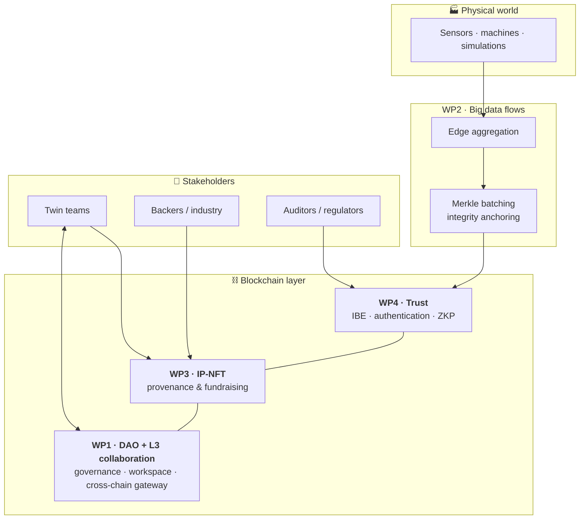
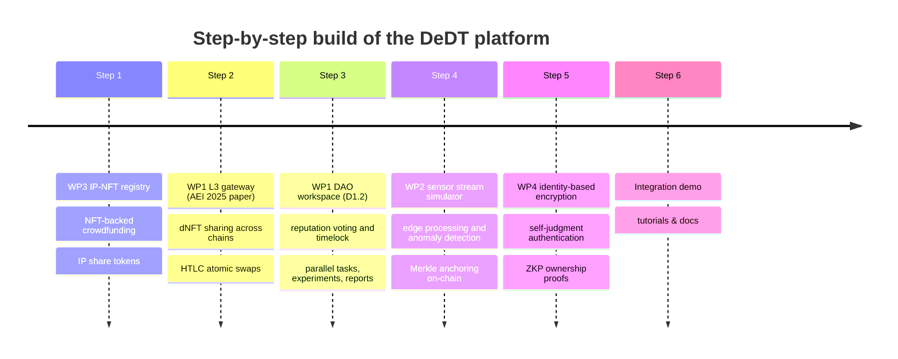

<div align="center">

# 🌐 DeDT Platform

### Blockchain-powered Digital Twins Platform to Foster Trust, Transparency, and Collaboration

[](https://smhbamakan.github.io/DeDT/)
[](LICENSE)
[](https://github.com/smhbamakan/DeDT-platform/actions/workflows/wp1-contracts.yml)
[](https://github.com/smhbamakan/DeDT-platform/actions/workflows/wp2-data-flows.yml)
[](https://github.com/smhbamakan/DeDT-platform/actions/workflows/wp3-contracts.yml)


</div>

Open-source code of the **DeDT** research project. DeDT explores how Web 3.0 technologies (**blockchain, NFTs and DAOs**) can solve the main problems of digital twin projects: tamper-proof data sharing, IP protection, decentralized fundraising and auditable predictive analytics.

---

## 🏗️ Platform overview



---

## 📦 Repository structure

| Folder | Work package | Objective | Tech | Status |
|---|---|---|---|---|
| [`wp1-dao-collaboration/`](wp1-dao-collaboration/) | **WP1** · DAO workspace for twin teams (D1.2) + L3 collaboration across blockchains (D1.3) | O1, O2 | Solidity · Hardhat · Python | ✅ Prototype + tests + figures |
| [`wp3-ip-nft-fundraising/`](wp3-ip-nft-fundraising/) | **WP3** · IP-NFTs & fundraising | O3 | Solidity · Hardhat | ✅ Prototype + tests |
| [`wp2-big-data-flows/`](wp2-big-data-flows/) | **WP2** · Big data flows: edge processing and on-chain integrity | O2 | Python · Solidity | ✅ Prototype + tests + experiments |
| [`wp4-trust-auditing/`](wp4-trust-auditing/) | **WP4** · Trust & auditing: identity-based encryption with distributed key servers, self-judging data authentication, zero-knowledge birth-certificate proofs | O4 | Python · Solidity | ✅ Prototype + tests + benchmarks |
| [`docs/`](docs/) | Documentation & tutorials | — | Markdown | 🔜 Step 6 |

Each folder is self-contained, with its own README, install steps and tests.

## 🗺️ Roadmap



---

## 🎯 Research objectives

| | Objective | Code |
|---|---|---|
| **O1** | Identify the crucial challenges of digital twin projects and evaluate how Web 3.0 technologies can resolve them | WP1 |
| **O2** | Develop a tamper-proof, decentralized collaboration platform for digital twin data sharing and federated learning | WP1, WP2 |
| **O3** | Design an IP-NFT framework for digital twin provenance and decentralized fundraising | WP3 |
| **O4** | Provide a blockchain-based predictive analytics platform for trust, transparency and auditability | WP4 |

## 👥 Team

- **Dr. Seyed Mojtaba Hosseini Bamakan**, MSCA Postdoctoral Fellow (Principal Investigator), Department of Business Management, Masaryk University · [Google Scholar](https://scholar.google.com/citations?user=YqXUN0AAAAAJ&hl=en&oi=ao)
- **Prof. Ahad Zareravasan**, Supervisor, Department of Business Management, Masaryk University

## 📚 Publications

> Banaeian Far, S., & Hosseini Bamakan, S. M. (2025). *Analyzing potential collaboration methods for digital twin teams developed on heterogeneous blockchains without a central authority.* **Advanced Engineering Informatics**, 68, 103616. https://doi.org/10.1016/j.aei.2025.103616

<details>
<summary>BibTeX</summary>

```bibtex
@article{banaeianfar2025collaboration,
  title   = {Analyzing potential collaboration methods for digital twin teams developed on heterogeneous blockchains without a central authority},
  author  = {Banaeian Far, Saeed and Hosseini Bamakan, Seyed Mojtaba},
  journal = {Advanced Engineering Informatics},
  volume  = {68},
  pages   = {103616},
  year    = {2025},
  doi     = {10.1016/j.aei.2025.103616}
}
```
</details>

## ⚖️ License

[MIT](LICENSE). The code is a research prototype and has not been audited; do not use it with real funds.

## 🇪🇺 Funding

This project is funded by the project “MSCAfellow7_MUNI” (CZ.02.01.01/00/22_010/0008854), co-funded by the European Union under the Operational Programme Johannes Amos Comenius (OP JAK).
