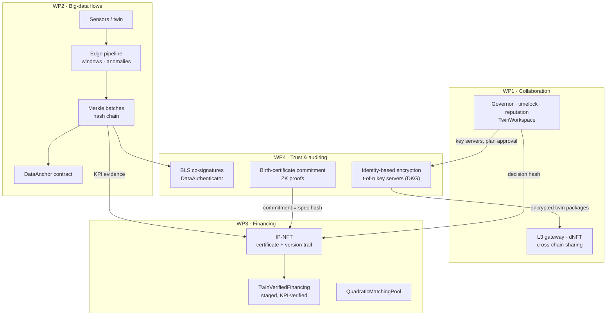

# Architecture

DeDT gives teams that build a digital twin together four things they lack: a way to **govern** the work
(WP1), **trustworthy data** (WP2), a way to **finance** it (WP3) and **cryptographic trust** between parties
that do not know each other (WP4).

## What links the modules

| Link | Carried by |
|---|---|
| Data → financing | KPI evidence = keccak(KPI id ‖ value ‖ hash-chain head ‖ model configuration), recorded in the IP-NFT version trail and referenced by each milestone claim |
| Certificate → NFTs | The Pedersen commitment to the birth certificate is the IP-NFT's specification hash and the dNFT's state hash |
| Governance → financing | The hash of the DAO decision that adopts a funding plan is recorded in the IP-NFT version trail |
| Governance → trust | The DAO timelock owns the key-server registry and the data authenticator settings |

All links are hashes, so a third party can verify them without trusting any team
([`integration/verify.py`](../integration/verify.py)).
