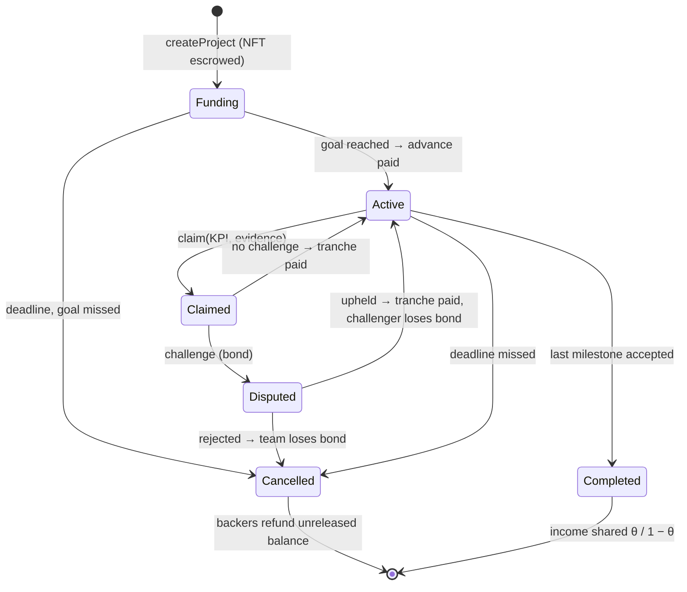

# Tutorial 2 · Financing a twin with DTVF

DTVF (Digital-Twin-Verified Financing, D3.2) releases money in stages when the twin's own data show that
a milestone is met. This tutorial explains the choices a team makes and how to run a project with
[`TwinVerifiedFinancing.sol`](../../wp3-ip-nft-fundraising/contracts/TwinVerifiedFinancing.sol).

## 1. Define milestones a machine can check

A good milestone has a **KPI that is a published function of twin data**, a **target** and a **deadline**.
Commit to the data *and* to the model configuration. Examples: data completeness ≥ 99 %, prediction
error ≤ 5 %, downtime reduction ≥ 10 % against a baseline period.

## 2. Choose the terms

| Term | Field | Guidance |
|---|---|---|
| Advance | `advance` | Enough to finance stage 1 |
| Bond | `bondBps` | At least (1 − q)/q of the tranche, where q is the chance a false claim is caught; 10–15 % if KPIs are recomputable |
| Challenge / vote window | `challengeWindow`, `voteWindow` | Long enough for a watcher to recompute the KPI (days, not hours) |
| Quorum | `quorumBps` | Share of capital that must vote for a rejection to count; 20 % in the pilot |
| Backer income share | `thetaBps` | Lower is possible with staging, because backers risk less |
| Team split | `team_`, `splitBps` | Agree before funding, e.g. from Shapley values of contributions |
| Compliance | `allowListOnly`, `capPerBacker` | For regulated or invitation-only offerings |

## 3. Lifecycle



## 4. Run the four pilot scenarios

```bash
cd wp3-ip-nft-fundraising
python pilot/kpi.py && npx hardhat run pilot/run-pilot.js
```

You will see an honest project, a false claim caught by a watcher, a frivolous challenge that fails and a
missed deadline — and in each case the contract ends with a zero balance.

## 5. Funding open components

Shared parts of a twin (schemas, reference models) can be funded through
[`QuadraticMatchingPool.sol`](../../wp3-ip-nft-fundraising/contracts/QuadraticMatchingPool.sol): many small
supporters attract more matching money than one large donor. Contributors must be verified.
