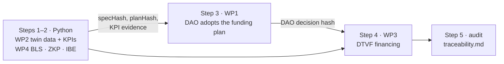

# 🔗 Integration demo · one digital twin through all four work packages

A single twin — **robot-arm-07** — goes through the whole DeDT stack. Each module runs with its own
toolchain; the modules are linked by **hashes that an independent auditor can recompute** (step 5).



| Step | Module | What happens | Output |
|---|---|---|---|
| 1 | WP2 | 11,379 readings → 30 Merkle batches in a hash chain; three KPIs computed from the data | `out/twin_trust.json` |
| 2 | WP4 | Sensors co-sign the last batch (aggregated BLS); birth certificate committed and proven in zero knowledge; twin package IBE-encrypted to a partner team (3-of-5 key servers) | `out/twin_trust.json` |
| 3 | WP1 | Team DAO mints the twin as dNFT with the certificate commitment and adopts the funding plan through governor + timelock | `out/dao.json` |
| 4 | WP3 | IP-NFT records the certificate, the DAO decision and three KPI evidences; 14 backers fund the plan; all milestones are claimed with that evidence and released | `out/funding.json` |
| 5 | — | 11 checks recompute every link | `out/traceability.md` |

## Run

```bash
pip install -r ../wp2-big-data-flows/requirements.txt -r ../wp4-trust-auditing/requirements.txt
(cd ../wp1-dao-collaboration && npm ci) && (cd ../wp3-ip-nft-fundraising && npm ci)
./run_demo.sh
```

## Scope

Steps 3 and 4 each start their own local Hardhat network, so the DAO and the financing contracts do not
share a chain in this demo; the link between them is the hash of the DAO decision recorded in the IP-NFT.
Deploying all modules to one test network is the next step towards the field pilot of D3.3.
