<div align="center">

# 🔗 WP1 · Distributed Collaboration Platform

**Twin teams run a shared workspace as a DAO (D1.2) and share twins across *different* blockchains (D1.3), with no central authority.**

[](https://github.com/smhbamakan/DeDT-platform/actions/workflows/wp1-contracts.yml)


</div>

> **Reference implementation of**
> S. Banaeian Far, S. M. Hosseini Bamakan, *Analyzing potential collaboration methods for digital twin teams developed on heterogeneous blockchains without a central authority*, **Advanced Engineering Informatics** 68 (2025) 103616. [doi:10.1016/j.aei.2025.103616](https://doi.org/10.1016/j.aei.2025.103616)
>
> The paper proposes a generic, modular **Layer-3 (L3) framework** (its Fig. 3 and Algorithms 1–4) and analyses four L3 mechanisms. It does not include a prototype (§6.1, *"Prototype absence"*). This folder provides one, and corrects the weak points of the paper's pseudocode along the way.

---

## 📦 What's inside

| Component | Paper | What it does |
|---|---|---|
| [`L3Gateway.sol`](contracts/L3Gateway.sol) | Table 14, Algorithms 1, 3, 4 | One gateway per chain. Encodes messages in a **Universal Transaction Schema (UTS)**; delivers them only with a **k-of-n validator quorum**; blocks replays. |
| [`DigitalTwinDNFT.sol`](contracts/DigitalTwinDNFT.sol) | Steps 1, 2, 13 · §2.3.3 | A twin project as a **dynamic NFT**, `S(t+1) = f(S(t), C)`. Can be shared with a team on another chain, which gets a *mirror* dNFT and can contribute back. |
| [`HashTimeLock.sol`](contracts/HashTimeLock.sol) | §3.1.1 (atomic swap) | **HTLC** for trustless cross-chain swaps, e.g. a twin dNFT on chain A for ETH on chain B. No validators involved. |
| [`lib/l3.js`](lib/l3.js) | Steps 9–12 | Off-chain validators (attest) and a permissionless relayer (deliver). Works with two real RPC endpoints or one local network. |
| [`analysis/make_figures.py`](analysis/make_figures.py) | Tables 7, 17, 23 | Charts from our gas measurements and from the paper's evaluation tables. |
| [`contracts/dao/`](contracts/dao/) · [`lib/dao.js`](lib/dao.js) | Proposal WP1 · D1.2 | **The twin teams' DAO**: reputation, governor, timelock and the shared workspace (see the D1.2 section below). |

---

## 🏗️ Architecture (paper Fig. 3)

```mermaid
flowchart LR
    subgraph A["⛓️ Public blockchain A · domain 1001"]
        T1(["👥 DT team #1"])
        D1["DigitalTwinDNFT<br/><i>native twin</i>"]
        G1["L3Gateway A"]
        T1 -- "mint · update · share" --> D1
        D1 -- "dispatch(UTS)" --> G1
    end

    subgraph L3["🌐 The L3 network"]
        V["Validators<br/>k-of-n signatures"]
        R["Relayer<br/>(anyone)"]
        V --> R
    end

    subgraph B["⛓️ Public blockchain B · domain 2002"]
        G2["L3Gateway B"]
        D2["DigitalTwinDNFT<br/><i>mirror twin</i>"]
        T2(["👥 DT team #2"])
        G2 -- "handleL3Message" --> D2
        D2 -- "mirror dNFT" --> T2
    end

    G1 -. "MessageDispatched event" .-> V
    R -- "deliver(UTS, signatures)" --> G2
    T2 -. "contribute → flows back to A" .-> D2
```

### The 13 steps of the paper, as implemented

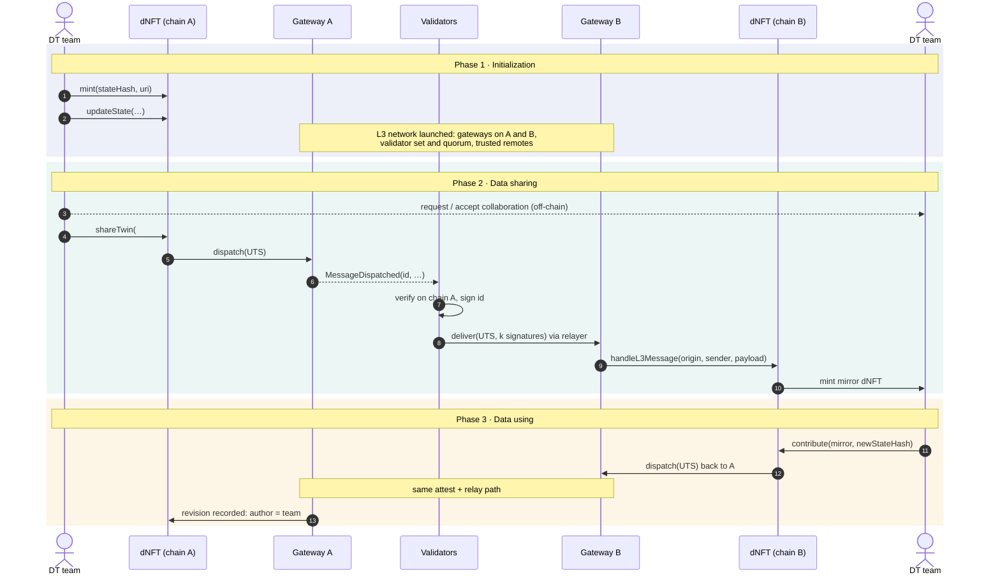

---

## 🏛️ D1.2 · The twin teams' DAO

The proposal's answer to WP1 is a **DAO that gives twin teams a common virtual workspace, managed by the teams themselves** (WP1 Solution). It should support **parallel intelligence, computational experiments and parallel execution** (WP1 Techniques). [`contracts/dao/`](contracts/dao/) implements it on OpenZeppelin Governor:

| Contract | Role |
|---|---|
| [`DTReputation.sol`](contracts/dao/DTReputation.sol) | **Non-transferable reputation = voting power.** Earned by contributing, lost when misbehaviour is upheld; it cannot be bought or moved. Whole points; holders are self-delegated automatically. |
| [`TwinTeamGovernor.sol`](contracts/dao/TwinTeamGovernor.sol) | **Proposals and voting** (for / against / abstain), proposal threshold, quorum as a share of total reputation, and a **voting cap**: no member's vote counts for more than 40 % of total reputation (changeable by vote). |
| `TimelockController` (OpenZeppelin) | **Delay before execution**, so members can react to a decision before it takes effect. It owns the workspace and the dNFT bridge configuration. |
| [`TwinWorkspace.sol`](contracts/dao/TwinWorkspace.sol) | **The workspace:** membership, twin projects, funded tasks run in parallel, computational experiments with endorsements, bonded misbehaviour reports, and the treasury. |

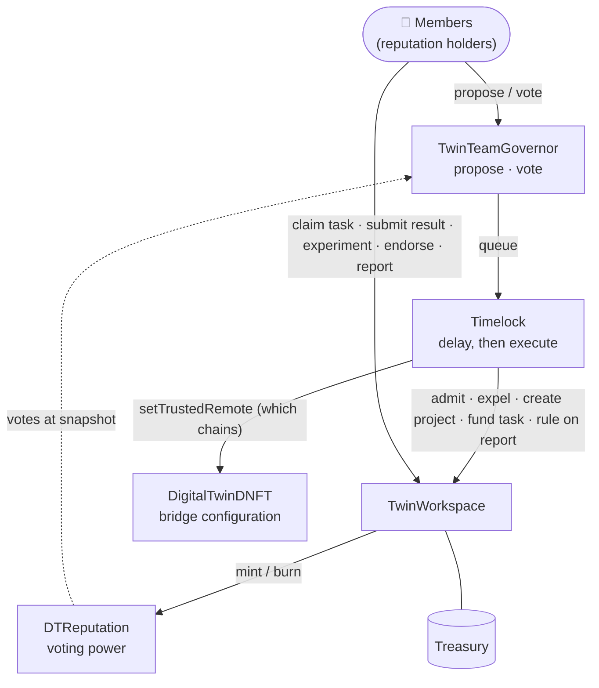

### What the DAO decides, and what members do directly

| By vote (`onlyDAO`) | Directly, as a member |
|---|---|
| Admit, reward or expel members | Claim a task, submit its result |
| Create a project around a twin dNFT and choose its lead | Record a computational experiment (configuration + result hashes) |
| Fund tasks from the treasury (bounty + reputation) | Endorse another member's experiment (weighted by reputation) |
| Rule on misbehaviour reports (slash, reward) | File a bonded misbehaviour report |
| Choose which blockchains the twins connect to | The **project lead** approves or rejects results; a lead's own work needs the DAO |

### Lifecycles

<table>
<tr>
<td width="50%">

**Proposal**

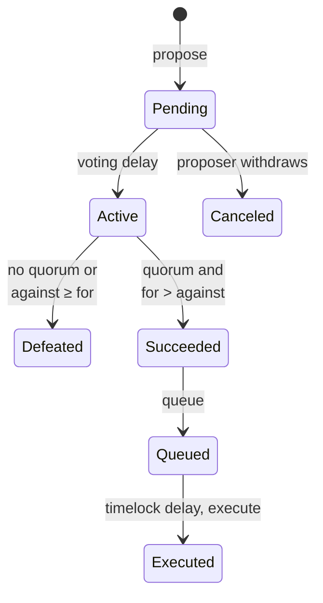
</td>
<td width="50%">

**Task (parallel workstreams)**

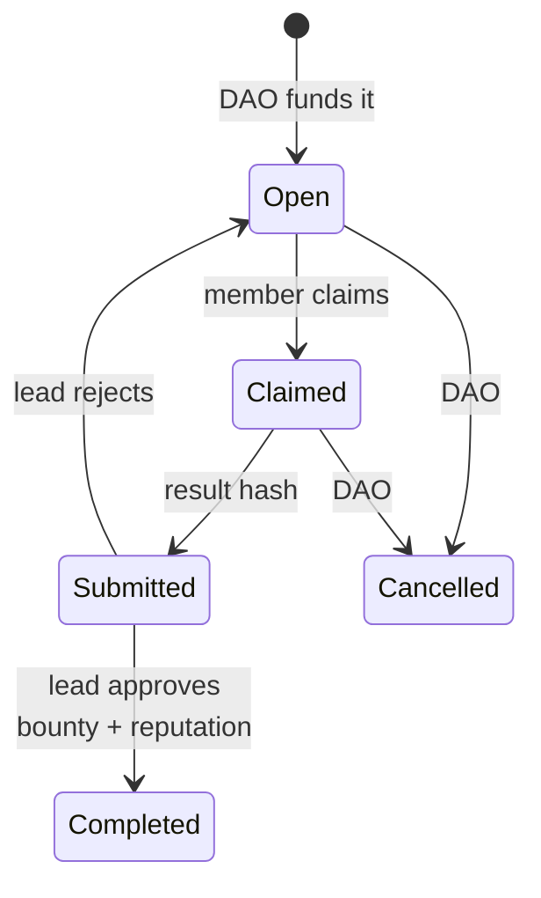
</td>
</tr>
</table>

**Collective monitoring.** Any member can report another member's misbehaviour by posting a bond. The DAO votes on the report:
- **Upheld:** the accused loses reputation, and the reporter gets the bond back plus a reputation reward.
- **Dismissed:** the bond goes to the treasury, which discourages spam reports.

This follows the reporting protocol of Banaeian Far & Hosseini Bamakan, *Blockchain-based reporting protocols as a collective monitoring mechanism in DAOs*, Data Science and Management 5(1), 2022, which the proposal cites for WP1. Pending bonds are kept apart from the treasury, so they can never fund a task.

### The D1.2 scenario (`npm run dao-demo`)

Three founding teams run the workspace together, and a fourth team joins by vote:
- Two tasks are carried out in parallel.
- One experiment is recorded and reproduced by other members.
- A report is upheld against a member who falsified data.
- The DAO decides which blockchain the twin connects to.

<picture>
  <source media="(prefers-color-scheme: dark)" srcset="docs/figures/dao-reputation-dark.png">
  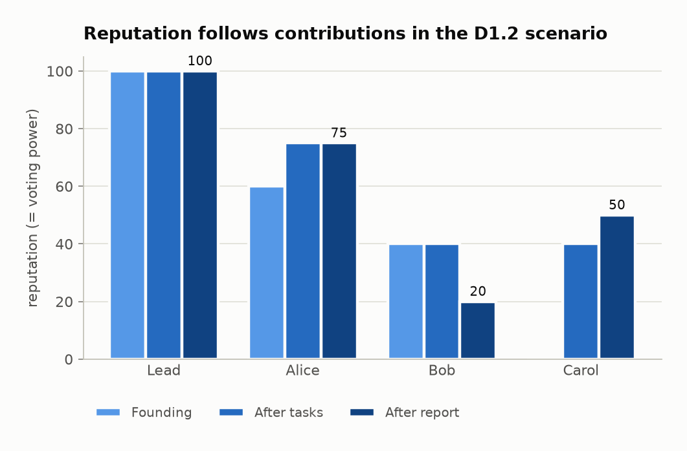
</picture>

<picture>
  <source media="(prefers-color-scheme: dark)" srcset="docs/figures/dao-votes-dark.png">
  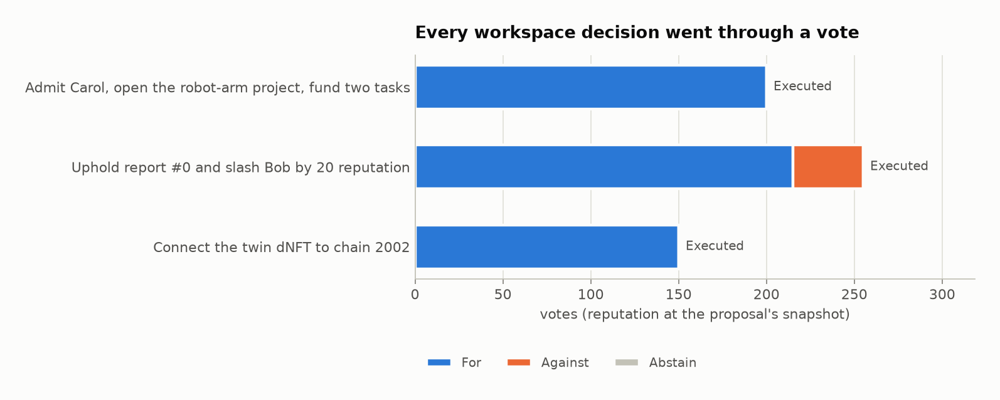
</picture>

<picture>
  <source media="(prefers-color-scheme: dark)" srcset="docs/figures/dao-gas-dark.png">
  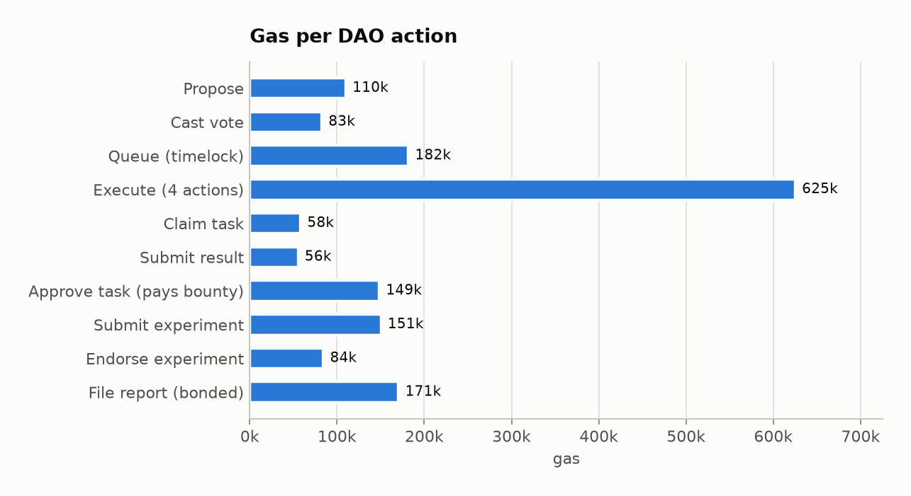
</picture>

<details>
<summary>Data tables</summary>

| Member | Founding | After tasks | After report |
|---|---:|---:|---:|
| Lead (manufacturing lab) | 100 | 100 | 100 |
| Alice (data science team) | 60 | 75 | 75 |
| Bob (IoT company) | 40 | 40 | 20 |
| Carol (university lab) | — | 40 | 50 |

| Proposal | For | Against | Result |
|---|---:|---:|---|
| Admit Carol, open the robot-arm project, fund two tasks | 180 ¹ | 0 | Executed |
| Uphold report #0 and slash Bob by 20 reputation | 215 | 40 | Executed |
| Connect the twin dNFT to chain 2002 | 148 ¹ | 0 | Executed |

| Action | Gas |
|---|---:|
| Propose | 110,242 |
| Cast vote (average) | 82,672 |
| Queue in timelock | 181,932 |
| Execute (4 actions) | 625,241 |
| Claim task | 58,405 |
| Submit result | 55,508 |
| Approve task (pays bounty, mints reputation) | 148,586 |
| Submit experiment | 150,567 |
| Endorse experiment | 84,476 |
| File report (bonded) | 170,672 |

¹ The lead holds 50 % of the reputation but votes with at most 40 % of the total because of the voting cap.
</details>

### Governance parameters (defaults in [`lib/dao.js`](lib/dao.js))

| Parameter | Default | Meaning |
|---|---|---|
| Voting delay | 1 block | Time to review a proposal before voting starts |
| Voting period | 20 blocks | Short for the demo; use about one week of blocks in production |
| Proposal threshold | 10 reputation | Minimum reputation to submit a proposal |
| Quorum | 20 % | Share of total reputation that must vote *for* or *abstain* |
| Voting cap | 40 % | Maximum weight of one member's vote; `setMaxVoteShare` by vote (0 = no cap) |
| Timelock delay | 1 hour | Short for the demo; use 1–2 days in production |

Production values (≈ 1 day delay, ≈ 1 week voting, 2-day timelock, 40 % cap) are the defaults of [`scripts/deploy-dao.js`](scripts/deploy-dao.js), which also checks after deployment that the deployer kept no rights:

```bash
npm run deploy:dao            # dry run on the in-memory network
npm run deploy:dao:sepolia    # public test network; set FOUNDERS and keys in .env (see .env.example)
```
| Report bond / reward | 0.1 ETH / 10 reputation | Changeable by vote (`setParameters`) |

---

## 🛠️ Corrections to the paper's pseudocode (Table 14)

The paper's `L3Network` contract shows the idea, but it reintroduces the central authority the framework is meant to remove. This implementation fixes that:

| # | Paper pseudocode | Problem | This implementation |
|---|---|---|---|
| 1 | `validateTransaction` is `onlyAdmin` | A single admin is a central authority and a single point of failure | **k-of-n validator quorum**; signatures must be sorted by signer, so duplicates are rejected |
| 2 | Users pass their own `transactionId` | IDs can collide or be front-run, and nothing binds them to the content | The gateway **derives the ID** from origin, destination, nonce, sender, recipient and payload hash |
| 3 | No chain binding | An attested message could be replayed on another chain | The ID includes **both domains**; `deliver` checks the destination; each ID is delivered **once** |
| 4 | `initiateTransaction` stores nothing | The "already exists" check never fires | **Nonce per gateway**, and the event carries the full UTS |
| 5 | Validation only sets a flag | Nothing happens on chain B | `deliver` **executes** the message on the recipient (`IL3Receiver`) |
| 6 | `string data` | Unstructured, expensive | `bytes payload`, with typed application messages (Share, Sync, Contribute, Revoke) |
| 7 | Fixed admin forever | No way to change who validates | **Validator rotation** signed by a quorum of the current set; old approvals cannot be replayed |
| 8 | Failure handling not specified | A failed delivery could be lost | If the recipient reverts, nothing is marked delivered and the message **can be relayed again** |

### 🔒 Hardening beyond the paper (found during the D1.3 security analysis)

| # | Risk | Fix | Test |
|---|---|---|---|
| R1 | Attestations covered only the domains, so two gateways deployed with the same domain number and validators would accept each other's signatures | The attestation digest binds the **destination chain ID and gateway address** (`DeDT-L3/attest/v2`) | *binds attestations to the destination gateway* |
| R2 | The gateway does not order messages, so a *Revoke* and a later re-*Share* delivered in reverse order left the mirror revoked while the origin considered it shared | **Ordered channels**: each message carries a sequence number per (twin, partner chain, team, direction); an early message reverts and stays deliverable. A contribution that arrives after a revoke is consumed with a `ContributionRejected` event, so it never blocks the channel | *applies messages of a channel strictly in order*; *rejects a contribution … without blocking the channel* |

The first message on a channel stores its sequence counter (≈ 23k gas on each side); later messages on the same channel update it for ≈ 5k.

---

## 📊 Results

### Our measurements (this prototype, Hardhat EVM, `npm run benchmark`)

<picture>
  <source media="(prefers-color-scheme: dark)" srcset="docs/figures/gas-vs-quorum-dark.png">
  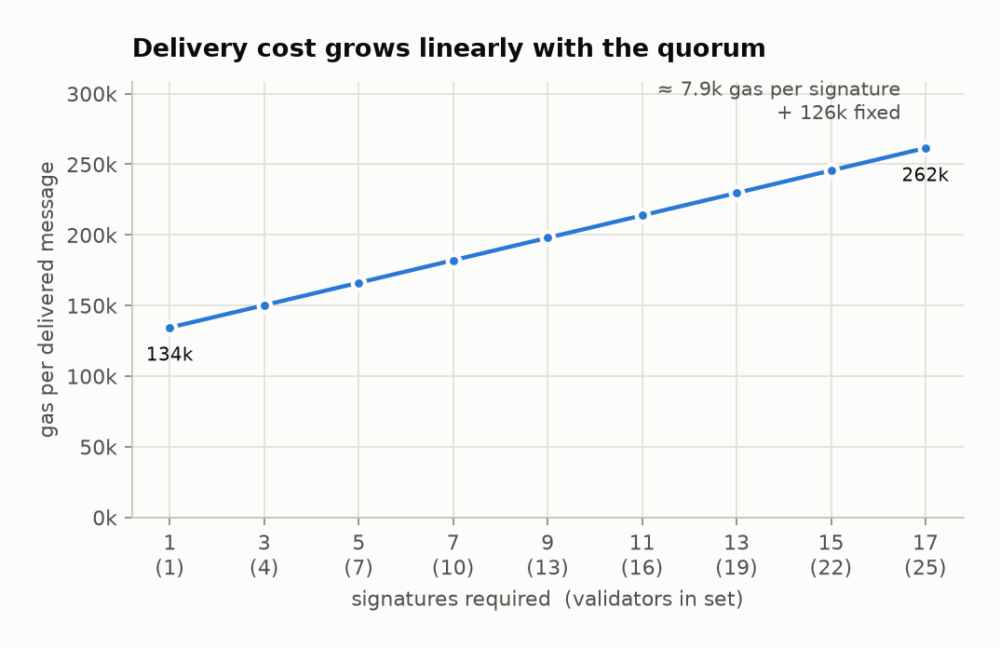
</picture>

Delivery cost is **≈ 126k + 7.9k × signatures**. Adding validators makes the bridge more decentralized at a predictable, linear cost. For example, a BFT quorum of 7 out of 10 validators costs 182k gas.

<details>
<summary>Data table</summary>

| Validators | Quorum (⌊2n/3⌋+1) | Gas to deliver |
|---:|---:|---:|
| 1 | 1 | 134,383 |
| 4 | 3 | 150,246 |
| 7 | 5 | 166,146 |
| 10 | 7 | 182,035 |
| 13 | 9 | 197,935 |
| 16 | 11 | 213,800 |
| 19 | 13 | 229,678 |
| 22 | 15 | 245,592 |
| 25 | 17 | 261,458 |

Dispatch cost by payload size: 32 B → 32,429 · 256 B → 37,909 · 1 KB → 63,400 · 4 KB → 185,890 gas. This is why only hashes and URIs of twin data go through the bridge.
</details>

<picture>
  <source media="(prefers-color-scheme: dark)" srcset="docs/figures/workflow-gas-dark.png">
  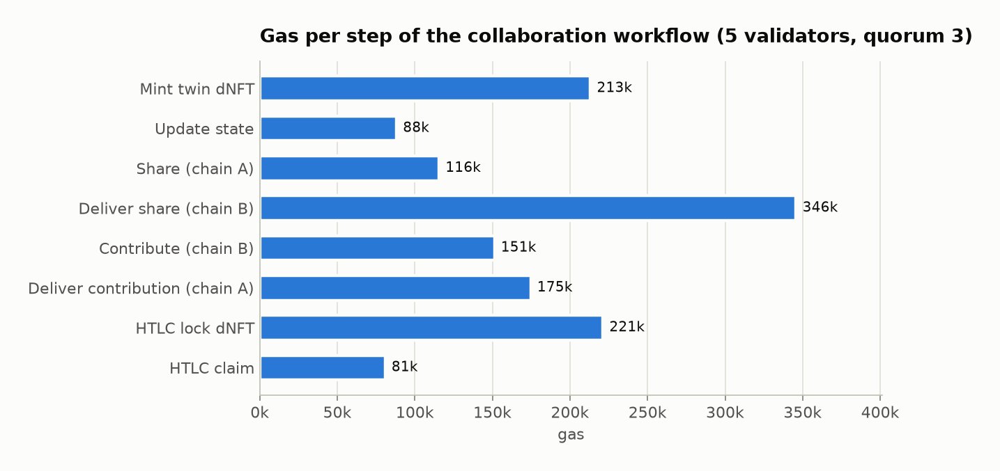
</picture>

<details>
<summary>Data table</summary>

| Step | Gas |
|---|---:|
| Mint twin dNFT | 213,173 |
| Update state | 88,178 |
| Share (chain A) | 115,601 |
| Deliver share (chain B, creates the mirror) | 345,778 |
| Contribute (chain B) | 151,300 |
| Deliver contribution (chain A) | 174,702 |
| HTLC lock dNFT | 221,231 |
| HTLC claim | 80,800 |
</details>

### From the paper's evaluation (values transcribed, simulated in the paper)

<picture>
  <source media="(prefers-color-scheme: dark)" srcset="docs/figures/paper-table23-dark.png">
  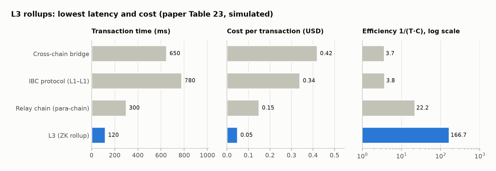
</picture>

`analysis/make_figures.py` recomputes the paper's efficiency metric, `Efficiency = 1 / (T_tx[s] · C_tx[USD])` (§4.6), from the time and cost columns: 3.66 · 3.77 · 22.22 · 166.67. This matches Table 23, except that the paper prints 3.75 for IBC.

<table>
<tr>
<td width="50%">
<picture>
  <source media="(prefers-color-scheme: dark)" srcset="docs/figures/paper-complexity-dark.png">
  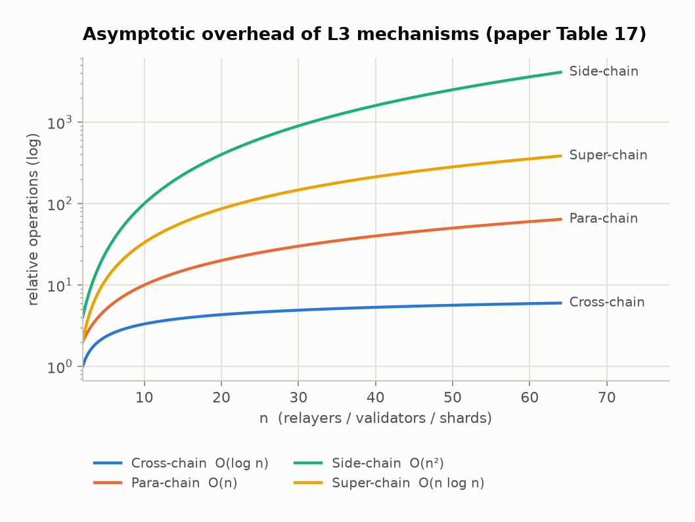
</picture>
</td>
<td width="50%">
<picture>
  <source media="(prefers-color-scheme: dark)" srcset="docs/figures/paper-profile-dark.png">
  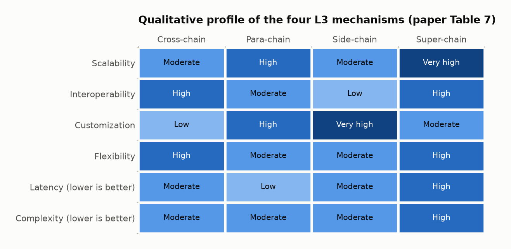
</picture>
</td>
</tr>
</table>

**Which mechanism does this prototype use?** `L3Gateway` is a **cross-chain bridge with decentralized relayers** (paper §4.2): it keeps each chain sovereign, needs no shared relay chain, and its verification cost grows only with the quorum. `HashTimeLock` adds the **atomic-swap** path (§3.1.1) for value exchange without any validators.

---

## 🚀 Quick start

```bash
cd wp1-dao-collaboration
npm install
npm test             # 55 tests
npm run demo         # the paper's 13 steps, end to end (D1.3)
npm run dao-demo     # the DAO workspace scenario (D1.2) → results/dao.json
npm run benchmark    # gas measurements → results/gas.json
npm run coverage
```

Regenerating the figures needs Python 3.10+ with matplotlib:

```bash
python -m venv .venv && .venv/bin/pip install matplotlib numpy   # Windows: .venv\Scripts\pip
.venv/bin/python analysis/make_figures.py
```

<details>
<summary><b>📺 Output of <code>npm run demo</code></b></summary>

```text
━━ Phase 1 · Initialization ━━━━━━━━━━━━━━━━━━━━━━━━━━━━━━━━━━━━
[Step  1] DT team #1 launches its project as a dNFT on public blockchain A
[Step  2] Team #1 develops the twin (new state version)
           twin #1 version 2
[Step  3] L3 developers collect the protocols of blockchains A and B
[Step  4] Algorithm 1: launch the L3 network — 5 validators, quorum 3, no admin
[Step  5] Deploy the L3 smart contracts on A and B and link the dNFT apps

━━ Phase 2 · Data sharing ━━━━━━━━━━━━━━━━━━━━━━━━━━━━━━━━━━━━━━
[Step  6] Team #1 asks team #2 to collaborate (off-chain agreement)
[Step  7] Team #1 looks up the L3 mechanism on blockchain A
[Step  8] Team #1 submits the L3 request: shareTwin(#1 → team #2 on B)
[Step  9] Algorithm 3: gateway A encodes the UTS and derives the message ID
[Step 10] The L3 transaction is emitted for the validators
[Step 11] Algorithm 4: validators verify and sign it
[Step 12] Relayer submits it to blockchain B
           3/5 validators attest 0x836af4ed…; relayer delivers it
           delivered on domain 2002 (gas 345850)
           team #2 now holds mirror dNFT #1 on B

━━ Phase 3 · Data using ━━━━━━━━━━━━━━━━━━━━━━━━━━━━━━━━━━━━━━━━
[Step 13] Team #2 modifies the shared twin; the change flows back to A
           3/5 validators attest 0xaac8ef82…; relayer delivers it
           delivered on domain 1001 (gas 174714)

  Provenance of twin #1 on blockchain A:
┌─────────┬─────────┬───────────┬───────┬───────────────┐
│ (index) │ version │ author    │ chain │ stateHash     │
├─────────┼─────────┼───────────┼───────┼───────────────┤
│ 0       │ 1       │ 'team #1' │ 'A'   │ '0x97eb8c2e…' │
│ 1       │ 2       │ 'team #1' │ 'A'   │ '0x063a4ebd…' │
│ 2       │ 3       │ 'team #2' │ 'B'   │ '0x09784748…' │
└─────────┴─────────┴───────────┴───────┴───────────────┘
```
</details>

---

## 📖 API

<details>
<summary><b>L3Gateway</b></summary>

| Function | Who | Description |
|---|---|---|
| `dispatch(destDomain, recipient, payload)` | any contract / account | Emits a UTS message; returns its ID |
| `deliver(uts, signatures)` | anyone (relayer) | Verifies the quorum, marks the message delivered, calls `recipient.handleL3Message` |
| `updateValidators(set, threshold, signatures)` | quorum of current validators | Rotates the validator set |
| `messageId(uts)` · `attestationDigest(id)` · `validatorSetDigest(set, t)` | view | What is hashed and signed |
| `delivered(id)` · `validators()` · `threshold()` | view | State |

</details>

<details>
<summary><b>DigitalTwinDNFT</b></summary>

| Function | Who | Description |
|---|---|---|
| `mint(stateHash, uri)` | anyone | New native twin (Step 1) |
| `updateState(id, stateHash, uri)` | owner or collaborator | New version of a native twin (Step 2) |
| `setCollaborator(id, account, allowed)` | owner | Local team members |
| `shareTwin(id, destDomain, team)` | owner | Sends a Share message, creating a mirror for `team` (Steps 6–12) |
| `syncTwin` · `revokeShare` | owner | Push the latest state / withdraw access |
| `contribute(mirrorId, stateHash, uri)` | mirror holder | Updates the mirror and sends the change to the origin (Step 13) |
| `twin(id)` · `historyLength(id)` · `revisionAt(id, i)` | view | State and provenance (author + chain of every revision) |
| `channelId(nativeDomain, tokenId, mirrorDomain, team, up)` · `nextOutSeq(ch)` · `nextInSeq(ch)` | view | Ordered channels: next sequence number to send / to accept |

Mirrors are **non-transferable**: access was granted to one specific team.
</details>

<details>
<summary><b>HashTimeLock</b></summary>

| Function | Description |
|---|---|
| `lockETH(receiver, hashlock, timelock)` / `lockNFT(receiver, token, id, hashlock, timelock)` | Lock under `H(s)` until `timelock` |
| `claim(id, s)` | Pays the receiver if `keccak256(s) == hashlock` before expiry; publishes `s` |
| `refund(id)` | Sender takes the asset back after expiry |

</details>

---

## 🛡️ Security model and limitations

- **Trust assumption:** a message is accepted only if at least `threshold` of the `n` validators sign it. With `threshold = ⌊2n/3⌋ + 1`, the bridge tolerates up to ⌊(n−1)/3⌋ faulty or malicious validators.
- **Liveness:** relaying is permissionless, so anyone can deliver an attested message. Validators that go offline only delay delivery.
- **Binding and order:** signatures are valid only on the gateway they were collected for (chain ID + address), and twin messages are applied in order per channel (R1, R2 above).
- **Privacy:** only hashes and URIs cross the bridge. Zero-knowledge ownership proofs (paper §3.6.1) are planned in WP4.
- **Two domains, one EVM:** tests and the demo simulate chains A and B as two gateways on one local network with different domain IDs. `lib/l3.js` takes ordinary ethers contracts, so the same code can relay between two real RPC endpoints.
- **DAO:** reputation is earned, so founding members start with more of it. The voting cap limits any single member to 40 % of the vote, and the DAO can rebalance reputation by vote (`grantReputation`, `expelMember`). The L3 validator set is rotated by the validators themselves, not by the DAO, so a captured DAO cannot take over the bridge.
- **Not yet implemented:** validator staking and slashing, fees for relayers, para-, side- and super-chain variants of the framework, and governance that spans several chains.

> ⚠️ Research prototype. It has not been audited, so do not use it with real assets.

---

## 🗺️ Mapping to the proposal

| Proposal | Status |
|---|---|
| **T1.1** Review blockchain, NFT and DAO protocols & standards | ✅ Published: the AEI 2025 review above (§2–3) |
| **T1.3** Framework for integrating Web 3 technologies into digital twins | ✅ Generic L3 framework (paper §4) + this implementation |
| **D1.3** Secure and accessible data-sharing platform | 🧪 Prototype: `L3Gateway` + `DigitalTwinDNFT` |
| **D1.2** DAO platform providing a virtual workspace for twin teams | 🧪 Prototype: `contracts/dao/` — reputation-weighted governance, timelock, projects, parallel tasks, experiments, reports |

---

<sub>Part of <a href="../README.md">DeDT Platform</a> · MIT License</sub>
