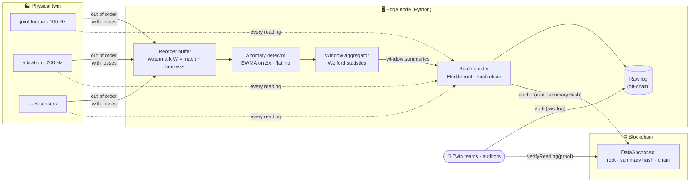
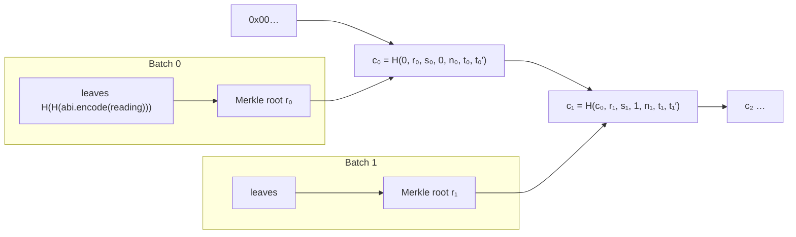
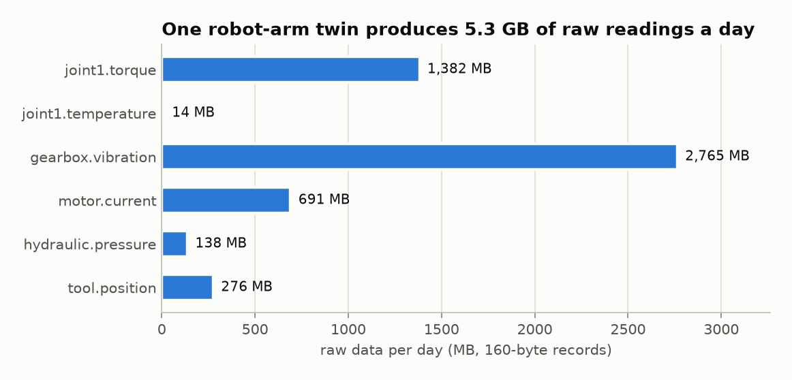
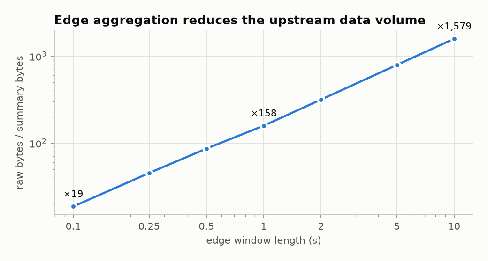
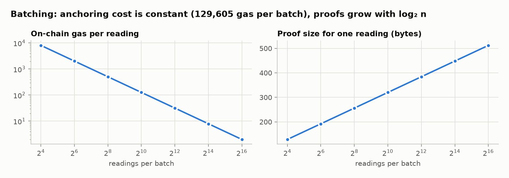
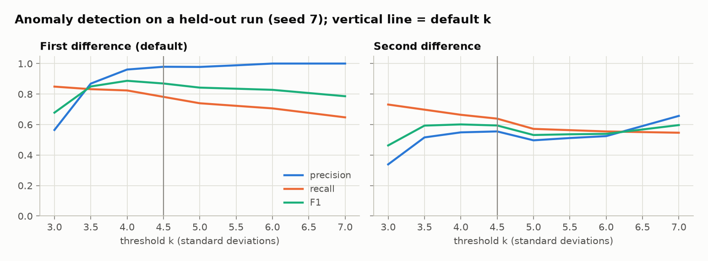
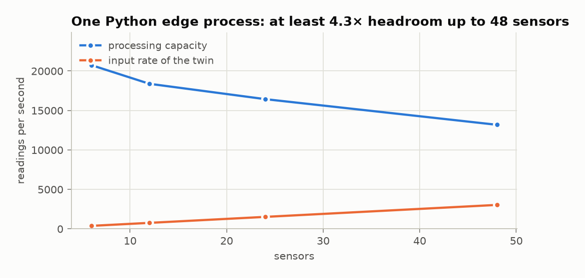

<div align="center">

# 📡 WP2 · Digital Twin Big Data Flows

**Simulate, process at the edge and prove the integrity of a digital twin's sensor streams — with only one hash per batch on-chain.**

[](https://github.com/smhbamakan/DeDT-platform/actions/workflows/wp2-data-flows.yml)


</div>

## 📌 The problem

A digital twin receives data from thousands of distributed sensors — temperature, pressure, speed, vibration — that form a big-data flow with high **volume**, **velocity** and **variety**, and are difficult to aggregate and merge (proposal, WP2). Teams that share a twin must also be able to **trust** that flow: that nobody altered, removed or injected readings after the fact.

Writing every reading to a blockchain is impossible at this rate: one robot-arm twin in our simulation produces **≈ 380 readings per second, 5.3 GB a day**. This module shows the alternative:

1. **process the stream at the edge** (reorder, detect anomalies, aggregate into compact summaries), and
2. **anchor only a Merkle root per batch** on-chain, linked in a hash chain, so that any stored raw log can later be audited and any single reading proven.

| Proposal task | Implementation | Evidence |
|---|---|---|
| **T2.1** Characteristics of DT big data flows | [`simulator.py`](dedt_flows/simulator.py): 6 sensors at 1–200 Hz, noise, drift, anomalies, loss, network jitter | E1, E5 |
| **T2.2** Blockchain for data integrity | [`merkle.py`](dedt_flows/merkle.py), [`integrity.py`](dedt_flows/integrity.py), [`DataAnchor.sol`](chain/contracts/DataAnchor.sol) | E3, E6, Solidity tests |
| **T2.3** Edge computing for low latency | [`edge.py`](dedt_flows/edge.py): watermark windows, streaming statistics, online anomaly detection | E2, E4, E5 |
| **T2.4** Data-flow management solutions | [`pipeline.py`](dedt_flows/pipeline.py): reordering, aggregation, batching, anchoring | All |

---

## 🏗️ Architecture



### What is anchored



A reading is encoded exactly like Solidity's `abi.encode(bytes32 twin, bytes32 sensor, uint64 seq, uint64 tEventMs, int256 valueMicro)` and double-hashed as in OpenZeppelin's `StandardMerkleTree`; internal nodes hash sorted pairs, so `MerkleProof.verify` accepts proofs built in Python. The Solidity tests check this on a fixture produced by the Python pipeline, and `npm run anchor` checks that **all 60 chain hashes** computed on-chain match the Python ones.

---

## 📊 Results

All numbers come from the scripts in this folder (`python -m dedt_flows.experiments`, `npm run anchor`); data in [`results/`](results/).

### E1 · Volume and velocity (T2.1)

<picture>
  <source media="(prefers-color-scheme: dark)" srcset="docs/figures/wp2-volume-dark.png">
  
</picture>

In a 60-second run the twin produced 22,860 readings; **0.54 %** were lost in transit and **37 %** arrived out of event-time order — the variety and disorder the edge must cope with.

### E2 · Data reduction at the edge (T2.3, T2.4)

<picture>
  <source media="(prefers-color-scheme: dark)" srcset="docs/figures/wp2-reduction-dark.png">
  
</picture>

Sending 1-second window summaries (count, min, max, mean, standard deviation, anomaly count) instead of raw readings reduces the upstream volume **158 times**; the raw log stays at the edge, protected by the anchored roots.

### E3 · Cost of on-chain integrity (T2.2)

<picture>
  <source media="(prefers-color-scheme: dark)" srcset="docs/figures/wp2-batching-dark.png">
  
</picture>

| Measured on Hardhat EVM | Value |
|---|---:|
| Gas per anchored batch (steady state) | **129,605** |
| Batches / readings in the 60-s run | 60 / 22,736 |
| Gas per reading at 1-s batches | **342** |
| Gas to verify one reading on-chain (8-hash proof) | 35,940 |

Anchoring cost does not depend on batch size, so the cost per reading falls as 1/n while a proof grows only as 32·⌈log₂ n⌉ bytes. The batch interval is the trade-off: longer batches are cheaper, shorter ones give a fresher integrity guarantee.

### E4 · Anomaly detection (T2.4)

<picture>
  <source media="(prefers-color-scheme: dark)" srcset="docs/figures/wp2-detection-dark.png">
  
</picture>

The threshold k = 4.5 and the first-difference statistic were chosen on one run (seed 11) and evaluated on another (seed 7): **precision 0.98, recall 0.78, F1 0.87** (93 true, 2 false alarms, 26 missed). The second-difference variant is clearly worse because it amplifies noise √6 times. Missed anomalies are mostly the first reading of a stuck sensor and small spikes on the fast-moving tool position.

### E5 · Throughput (velocity)

<picture>
  <source media="(prefers-color-scheme: dark)" srcset="docs/figures/wp2-throughput-dark.png">
  
</picture>

A single Python process — reordering, detection, aggregation, hashing and Merkle trees included — keeps at least **4×** ahead of the input rate up to 48 sensors (eight robot arms). Throughput varies by a few percent between runs on the same machine.

### E6 · Tamper detection (T2.2)

| Attack on the stored raw log (50 random trials each) | Detected | Localised to the right batch |
|---|:---:|:---:|
| Modify one value by 10⁻⁶ | 100 % | 100 % |
| Delete one reading | 100 % | 100 % |
| Insert a forged reading | 100 % | 100 % |
| Shift one timestamp by 1 ms | 100 % | 100 % |
| Swap two batches (log and records consistently) | 100 % | 100 % (hash chain) |

Detection is deterministic: it fails only if keccak-256 has a collision.

---

## 🚀 Quick start

```bash
cd wp2-big-data-flows
python -m venv .venv && .venv/bin/pip install -r requirements.txt   # Windows: .venv\Scripts\pip
.venv/bin/python -m pytest -q                       # 32 tests
.venv/bin/python -m dedt_flows.pipeline             # 60 s of a robot-arm twin → out/anchors.json

cd chain && npm install
npm test                                            # 6 tests on the Python-generated fixture
npm run anchor                                      # anchor all batches, check chain hashes, measure gas

cd .. && .venv/bin/python -m dedt_flows.experiments # E1–E6 figures and results/experiments.json
```

<details>
<summary><b>📺 Output of the pipeline</b></summary>

```text
twin robot-arm-07: 6 sensors, 60 s
  received 22,736 readings (loss 0.54%, out of order 37.0%, late 0.00%)
  edge: 360 window summaries, data reduction x158
  anomalies: precision 0.98, recall 0.78, F1 0.87
  integrity: 60 batches anchored by Merkle root + hash chain
  throughput 19,278 readings/s (single Python process)
```
</details>

---

## 📖 Modules

| Module | Key elements |
|---|---|
| [`encoding.py`](dedt_flows/encoding.py) | keccak-256, ABI words, `encode_reading`, `leaf_hash` (shared with Solidity) |
| [`merkle.py`](dedt_flows/merkle.py) | `MerkleTree.build/proof`, `verify` — OpenZeppelin-compatible |
| [`simulator.py`](dedt_flows/simulator.py) | `SensorSpec`, `ROBOT_ARM`, `SimulationConfig`, `simulate()` (arrival order, ground-truth anomalies) |
| [`edge.py`](dedt_flows/edge.py) | `EdgeAggregator` (reorder buffer, watermark windows), `Welford`, `AnomalyDetector`, `detection_scores` |
| [`integrity.py`](dedt_flows/integrity.py) | `BatchBuilder`, `seal`, `chain_hash`, `audit`, `verify_reading` |
| [`pipeline.py`](dedt_flows/pipeline.py) | `run()` end to end, metrics, anchor export, Solidity fixture |
| [`experiments.py`](dedt_flows/experiments.py) | E1–E6 and figures |
| [`DataAnchor.sol`](chain/contracts/DataAnchor.sol) | `registerTwin`, `setSubmitter`, `anchor`, `verifyReading`, `batch` |

## 🛡️ Assumptions and limitations

- **Trust boundary:** the anchors prove that the log has not changed *since* the edge sealed it. A compromised edge node could anchor false data in the first place; mitigations are several independent edge nodes per twin and signed sensor firmware (WP4).
- **Synthetic data:** sensors, anomalies and network behaviour are simulated with documented parameters; results on real twin data are future work.
- **Single process:** throughput is for one Python process; a production edge would use a compiled stream processor, which only strengthens the conclusion.
- **Local chain:** gas was measured on Hardhat's EVM; fees on a given chain follow from its gas price.

> ⚠️ Research prototype. It has not been audited.

## 🗺️ Mapping to the deliverables

| Deliverable | Status |
|---|---|
| **D2.1** Applicability of blockchain for data integrity in DT environments | 🧪 Technical basis here (E3, E6); report planned |
| **D2.2** Methods and algorithms for data-flow management | 🧪 Prototype: this module |
| **D2.3** Performance evaluation of the data-flow solutions | 🧪 First results: E1–E6 |

---

<sub>Part of <a href="../README.md">DeDT Platform</a> · MIT License</sub>
