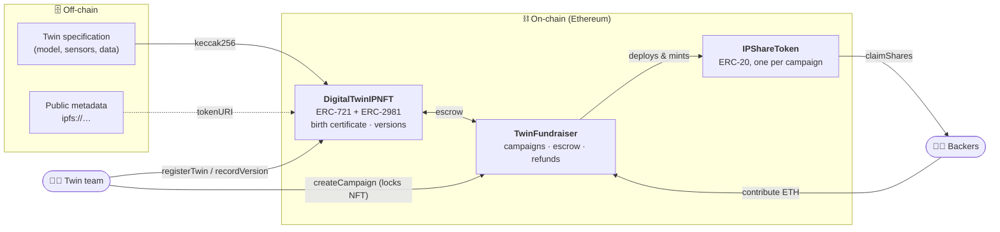
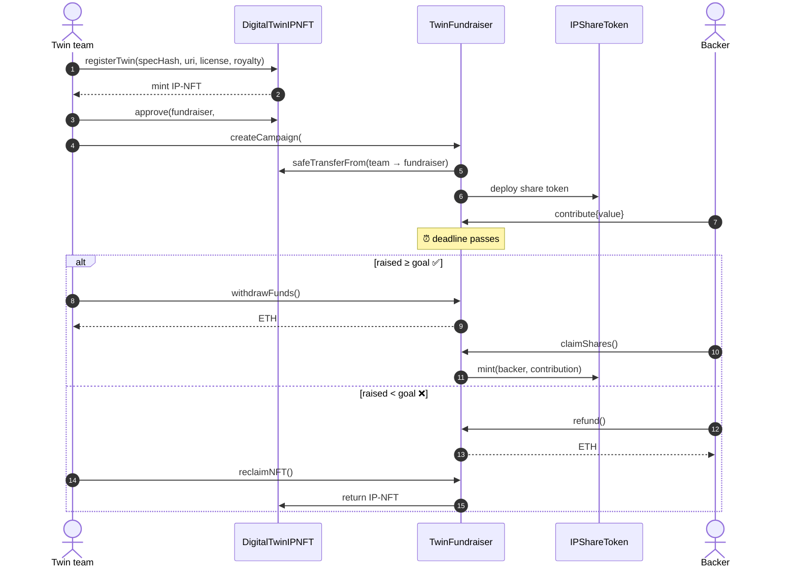
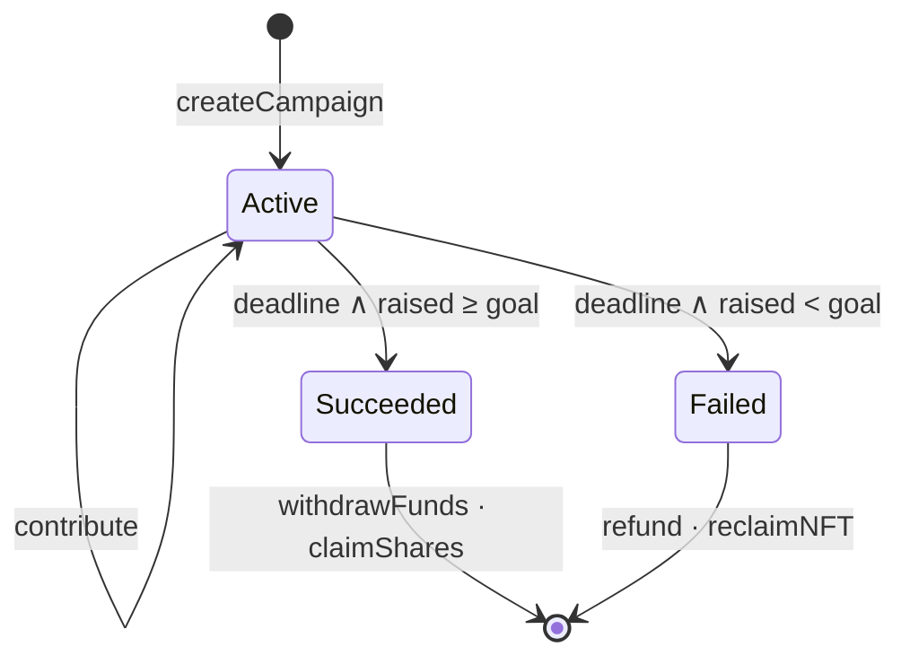

<div align="center">

# 🧬 WP3 · IP-NFTs & Fundraising for Twin Teams

**Register a digital twin as an Intellectual Property NFT, prove its provenance, and crowdfund it — on-chain.**

[](https://github.com/smhbamakan/DeDT-platform/actions/workflows/wp3-contracts.yml)


</div>

---

## 📌 What problem does this solve?

Digital twin teams invest heavily in models, data and know-how, but:

| Challenge | How WP3 addresses it |
|---|---|
| 🔒 **IP & commercial information** must stay confidential | Only a **hash** of the twin specification (its *birth certificate*) goes on-chain |
| 🧾 **Ownership & provenance** are hard to prove | Each twin is an **ERC-721 IP-NFT** with an append-only **version history** |
| 💰 **Early-stage funding** is scarce | **All-or-nothing crowdfunding** backed by the IP-NFT; backers receive **IP shares** |
| 🤝 **Fair rewards** for creators | **ERC-2981 royalties** on every secondary sale |

| Deliverable | Description | Status |
|---|---|---|
| D3.1 | Financial requirements of twin teams | 📝 Planned (report) |
| D3.2 | NFT funding model implementation | ✅ Prototype in this folder |
| D3.3 | Pilot experiments on NFT-funded projects | 🧪 Demo script ready; pilot data to come |

---

## 🏗️ Architecture



| Contract | Standard | Responsibility |
|---|---|---|
| [`DigitalTwinIPNFT.sol`](contracts/DigitalTwinIPNFT.sol) | ERC-721, ERC-2981 | Registers twins, stores the birth certificate & provenance trail, royalties |
| [`TwinFundraiser.sol`](contracts/TwinFundraiser.sol) | ERC-721 receiver | Locks the IP-NFT, collects contributions, pays out or refunds |
| [`IPShareToken.sol`](contracts/IPShareToken.sol) | ERC-20 | Fungible shares of one IP-NFT, minted only by the fundraiser |

---

## 🔄 Fundraising flow



### Campaign states



---

## 🚀 Quick start

Requires Node.js 18+.

```bash
cd wp3-ip-nft-fundraising
npm install
npm test          # 16 unit tests
npm run demo      # end-to-end walkthrough
npm run coverage  # coverage report
```

<details>
<summary><b>📺 Example output of <code>npm run demo</code></b></summary>

```text
[1] Twin team registers its digital twin as an IP-NFT
    token #1 owner   0xf39Fd6e51aad88F6F4ce6aB8827279cffFb92266
    birth cert hash  0xbcd2bed342a049cec30f338a51f28c466f4a5c4c45bc74d40e85d2556250255a
    verifySpec(original)  → true
    verifySpec(tampered)  → false

[2] The team records a model update in the provenance trail
    versions: 2

[3] The team locks the IP-NFT and opens a 30-day campaign with a 10 ETH goal
[4] Backers contribute
    raised 10.0 ETH
[5] Deadline passes → campaign succeeded
    state: Succeeded
[6] Team withdraws funds, backers claim IP shares
┌─────────┬────────┐
│ (index) │ shares │
├─────────┼────────┤
│ alice   │ '6.0'  │
│ bob     │ '4.0'  │
└─────────┴────────┘
```
</details>

### Deploy

```bash
# Local chain
npm run node            # terminal 1
npm run deploy:local    # terminal 2

# Sepolia testnet: copy .env.example to .env and fill it in
npm run deploy:sepolia
```

---

## 📖 Contract API

<details>
<summary><b>DigitalTwinIPNFT</b></summary>

| Function | Who | Description |
|---|---|---|
| `registerTwin(specHash, uri, license, royaltyBps)` | anyone | Mints a new IP-NFT; rejects empty or already registered specs |
| `recordVersion(tokenId, dataHash, note)` | owner or creator | Appends a version to the provenance trail |
| `birthCertificate(tokenId)` | view | `specHash`, `creator`, `createdAt`, `license` |
| `verifySpec(tokenId, specHash)` | view | `true` if an off-chain spec matches the registered one |
| `versionCount(tokenId)` / `versionAt(tokenId, i)` | view | Read the provenance trail |
| `tokenOfSpec(specHash)` | view | Token registered for a spec (0 if none) |
| `royaltyInfo(tokenId, price)` | view | ERC-2981 royalty |

</details>

<details>
<summary><b>TwinFundraiser</b></summary>

| Function | Who | When |
|---|---|---|
| `createCampaign(tokenId, goal, duration)` | NFT owner | duration 1 hour – 365 days |
| `contribute(id)` | anyone | Active |
| `withdrawFunds(id)` | creator | Succeeded, once |
| `claimShares(id)` | backer | Succeeded, once per backer |
| `refund(id)` | backer | Failed |
| `reclaimNFT(id)` | creator | Failed, once |
| `state(id)` / `campaign(id)` / `contributionOf(id, addr)` | view | always |

</details>

---

## 🛡️ Design notes

- **Privacy by design:** confidential twin details never touch the chain; only their hash does. WP4 extends this with zero-knowledge ownership proofs.
- **Pull payments:** each party withdraws their own funds; there are no loops over backers and no push transfers.
- **Re-entrancy protection** on every function that sends ETH (`ReentrancyGuard` and the checks-effects-interactions pattern).
- **Custom errors** for clear, gas-efficient reverts.
- **Locked IP after success:** the IP-NFT stays in the fundraiser as the asset behind the share token. Governance of that IP by shareholders is planned with the WP1 DAO.

> ⚠️ Research prototype. It has not been audited, so do not use it with real funds.

---

## 🗺️ Mapping to the proposal

| Task / deliverable | Implementation |
|---|---|
| T3.1 · NFTs for project fundraising | `TwinFundraiser` all-or-nothing model |
| T3.2 · Trusted DT architecture protecting IP | hash-only birth certificate, provenance trail |
| T3.3 · NFT-powered funding model | IP-NFT escrow + `IPShareToken` |
| T3.4 · Pilot experiments | `scripts/demo.js`, test suite (to be extended with pilot data) |
| **D3.2** · NFT-funding model implementation | this folder |

---

<sub>Part of <a href="../README.md">DeDT Platform</a> · MIT License</sub>
