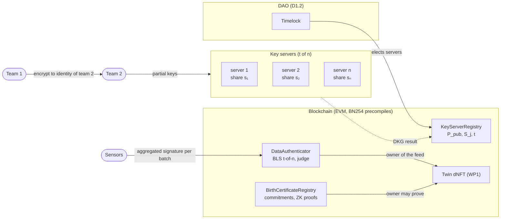
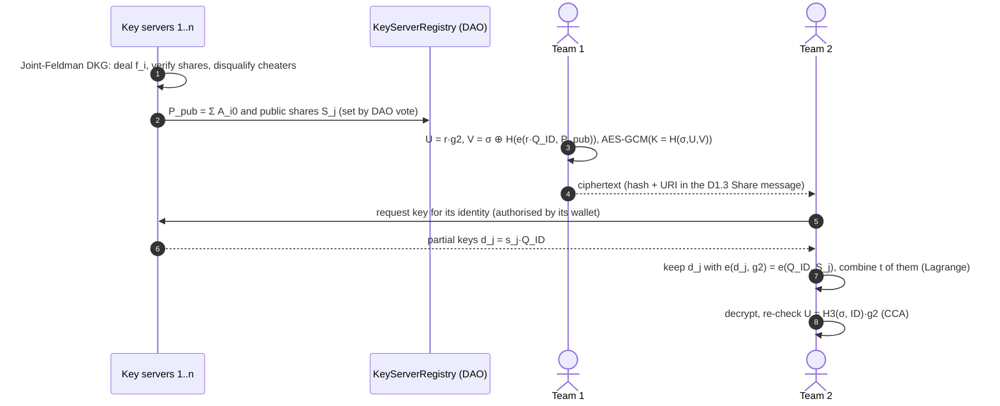
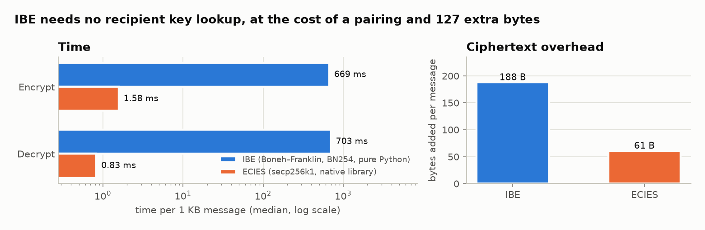
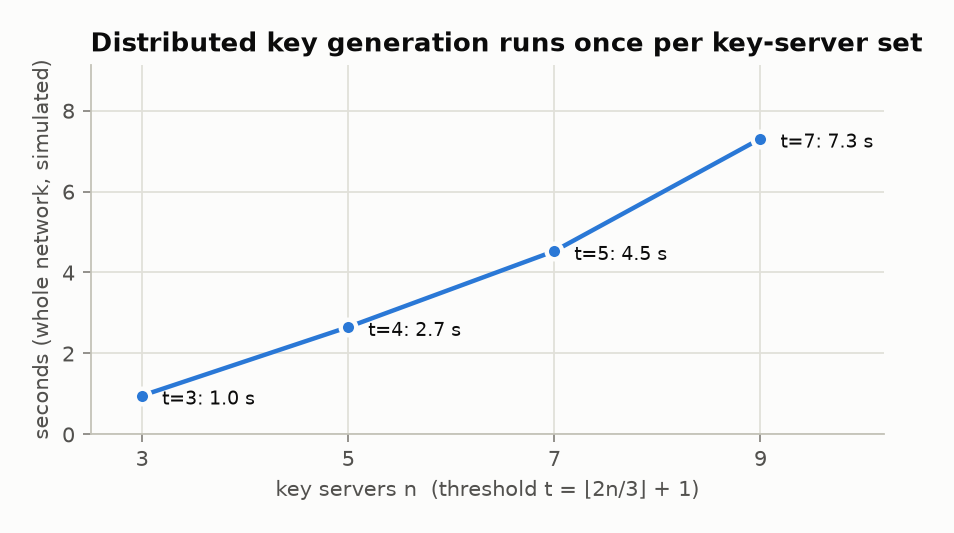
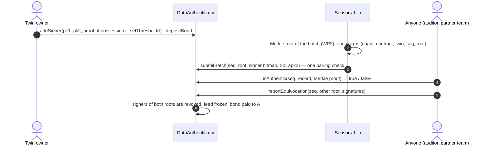
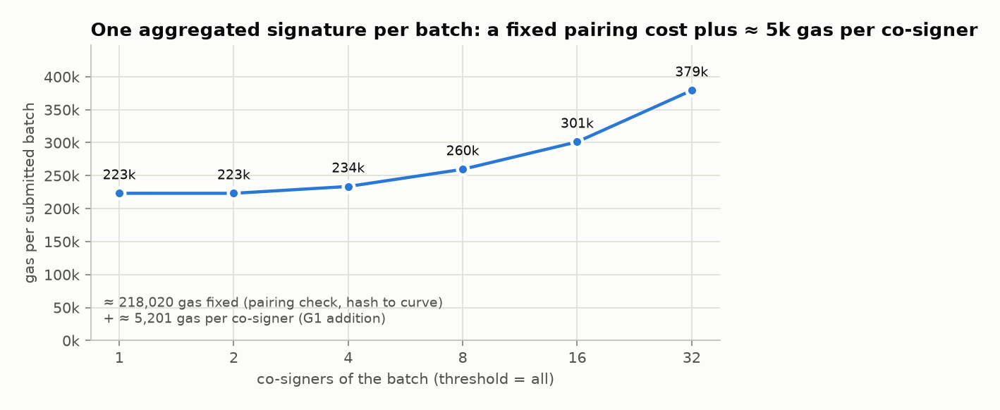
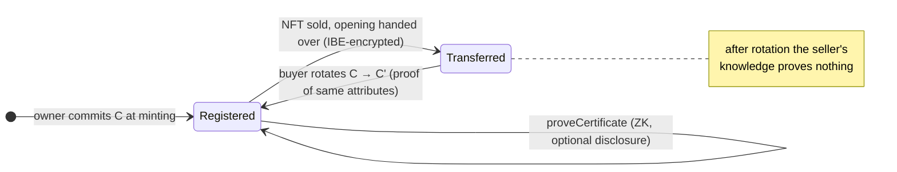
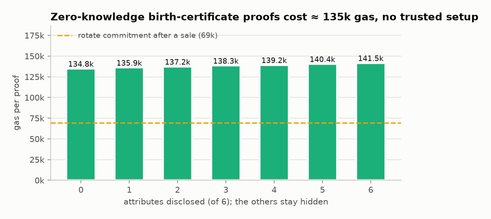

# 🔐 WP4 · Trust & Auditing for Digital Twin Teams (O4)


-blue)


Cryptography that lets twin teams **exchange confidential data, prove that data are authentic and prove ownership of a twin — without a central authority and without revealing secrets**. Every on-chain check runs on the EVM's own BN254 precompiles, so no trusted setup and no external verifier are needed.

| Task | What this module provides | Code |
|---|---|---|
| **T4.1** Identity-based encryption for twin teams | Boneh–Franklin IBE (CCA-secure FullIdent KEM + AES-256-GCM). The master key is **shared among t-of-n key servers by a distributed key generation**, so there is no all-knowing key centre | [`ibe.py`](dedt_trust/ibe.py) · [`dkg.py`](dedt_trust/dkg.py) · [`KeyServerRegistry.sol`](chain/contracts/KeyServerRegistry.sol) |
| **T4.2** Self-judgment data authentication | Sensors co-sign each data batch with **one aggregated BLS signature**; the contract judges any record and **convicts equivocating signers by itself** | [`bls.py`](dedt_trust/bls.py) · [`DataAuthenticator.sol`](chain/contracts/DataAuthenticator.sol) |
| **T4.3** ZKPs linking DT birth certificates and NFTs | Pedersen commitment to the birth certificate on the NFT; **zero-knowledge proofs with selective disclosure**, bound to the prover; commitment rotation after a sale | [`zkp.py`](dedt_trust/zkp.py) · [`BirthCertificateRegistry.sol`](chain/contracts/BirthCertificateRegistry.sol) |
| **T4.4** Apply encryption and validity methods to team interconnections | End-to-end scenario: encrypted twin sharing between teams on two chains, authenticated data, ownership proof and transfer | [`demo.py`](dedt_trust/demo.py) |
| **D4.2** IBE vs. traditional methods | Benchmarks against ECIES on secp256k1 (the teams' Ethereum curve) | [`bench.py`](dedt_trust/bench.py) · [`baseline.py`](dedt_trust/baseline.py) |

---

## 🧭 Architecture



---

## 🔑 T4.1 · Identity-based encryption without a key centre

Team 1 encrypts to the **identity** of team 2, a string it can build from public facts:

```
dedt/v1|chain=2002|team=0xb2b2…b2|epoch=2026-10
```

No public key, certificate or directory lookup is needed, and keys expire with the epoch. The private key `d_ID = s·H(ID)` is issued by key servers. Plain IBE gives the key centre every team's key; here the master key `s` is **never assembled**:



| Property | How |
|---|---|
| Confidentiality (IND-ID-CCA, random oracles, BDH) | Boneh–Franklin FullIdent / Fujisaki–Okamoto re-encryption check |
| No key escrow by one party | t-of-n DKG; fewer than t servers learn nothing about `s` |
| Robustness against cheating servers | every partial key is verified with 2 pairings before use |
| Revocation | identities carry an epoch; servers stop issuing keys for revoked teams |

<picture>
  <source media="(prefers-color-scheme: dark)" srcset="docs/figures/wp4-ibe-vs-ecies-dark.png">
  
</picture>

> The timing gap mostly reflects the libraries: the pairing library [`py_ecc`](https://github.com/ethereum/py_ecc) is pure Python, while ECIES runs on OpenSSL. Operation counts (`results/bench.json`) are the implementation-independent comparison: IBE encryption = 1 pairing + 2 scalar multiplications + 1 hash to curve; decryption = 1 pairing + 1 scalar multiplication; ECIES = 2 / 1 scalar multiplications. With native pairing libraries a pairing takes on the order of a millisecond, so IBE stays interactive. The decisive differences are **operational**: no key directory and implicit expiry, against a pairing per message and 127 extra bytes.

<picture>
  <source media="(prefers-color-scheme: dark)" srcset="docs/figures/wp4-dkg-time-dark.png">
  
</picture>

---

## ⚖️ T4.2 · Self-judgment data authentication

**Working definition.** Data authentication is *self-judging* when the evidence travels with the data and a smart contract — not a trusted third party — decides (i) whether a record is authentic and (ii) whether its producers misbehaved, and applies the sanction automatically.



* **Constant-size evidence.** One 64-byte signature per batch, whatever the number of signers. Public keys live in G1 so the contract can add them (`0x06`); the caller supplies the G2 aggregate, which is checked within the same pairing equation:
  `e(σ + γ·apk₁, g₂) = e(H(m) + γ·g₁, apk₂)` with `γ = H(σ, apk₁, apk₂, H(m))`.
* **Rogue-key resistance.** Each signer proves possession of its key at registration; [`test_crypto.py`](tests/test_crypto.py) shows the forgery that would succeed without it.
* **Accountability.** With threshold `t > n/2`, any two accepted quorums share a signer, so a conflicting history always names a culprit.

<picture>
  <source media="(prefers-color-scheme: dark)" srcset="docs/figures/wp4-batch-gas-dark.png">
  
</picture>

The fixed cost is the pairing check (113k gas by the EIP-1108 schedule) plus hashing to the curve. Each co-signer adds about 5k gas (one G1 addition and one storage read). Per-signer ECDSA would cost less for a handful of signers. The benefit of BLS is a constant-size signature and constant-size equivocation evidence, not lower gas for small quorums.

---

## 🪪 T4.3 · Zero-knowledge birth certificate ↔ NFT

The birth certificate of a twin — asset type, manufacturer, serial number, date of birth, design-specification hash, initial state hash — stays private. The NFT carries only a Pedersen commitment `C = Σ mⱼ·Gⱼ + r·H`.



| Proof | Statement | Gas |
|---|---|---:|
| `proveCertificate` | "I, `msg.sender`, know the opening of the commitment of token #id; attributes D have these values" — Σ-protocol, Fiat–Shamir bound to chain, contract, token and prover | ≈ 135k – 142k |
| `rotateCommitment` | "C' commits to the same attributes as C" — Schnorr proof of `C − C' = Δ·H` | ≈ 69k |

<picture>
  <source media="(prefers-color-scheme: dark)" srcset="docs/figures/wp4-zkp-gas-dark.png">
  
</picture>

Predicates over hidden attributes, such as "born after 2020", need a SNARK. D4.3 proposes a Groth16 circuit as the next step; the commitment format here is compatible with it.

---

## 🔗 T4.4 · End-to-end scenario (`python -m dedt_trust.demo`)

```text
━━ 1 · Distributed key generation (5 key servers, any 3 suffice) ━━━━━
  • Joint-Feldman DKG finished; qualified servers [1, 2, 3, 4, 5]
━━ 2 · Team 1 shares an encrypted twin with team 2 ━━━━━━━━━━━━━━━━━━━
  • encrypted to identity 'dedt/v1|chain=2002|team=0xb2b2…b2|epoch=2026-10'
  • ciphertext 267 B = payload 79 B + 188 B; its hash and URI travel in the D1.3 Share message
━━ 3 · Team 2 obtains its key from the servers and decrypts ━━━━━━━━━━
  • server 1: partial key verified
  • server 2: offline
  • server 4: partial key INVALID — discarded
  • server 3: partial key verified
  • server 5: partial key verified
  • combined servers [1, 3, 5]; key valid: True
━━ 4 · Self-judging authentication of the twin's sensor data ━━━━━━━━━
  • batch 0 (8 readings) co-signed by sensors 0,1,2; valid: True
  • record 5 judged authentic: True; altered record: False
  • sensors 1 and 2 also signed a different root for batch 0 → equivocation proven
━━ 5 · Zero-knowledge link between the twin NFT and its birth certificate
  • team 1 proves the certificate, disclosing only the manufacturer: True
  • the same proof replayed by team 2: False
  • NFT sold to team 2, which rotates the commitment: True
  • team 1 (old opening) can still prove: False; team 2 can: True
```

---

## 🚀 Run it

```bash
cd wp4-trust-auditing
python -m venv .venv && . .venv/bin/activate      # Windows: .venv\Scripts\activate
pip install -r requirements.txt
python -m pytest -q                 # 28 Python tests (≈ 1.5 min, pure-Python pairings)
python -m dedt_trust.demo           # T4.4 scenario
python -m dedt_trust.bench          # results/bench.json

cd chain && npm install
npx hardhat test                    # 18 Solidity tests; keys and proofs come from the Python reference
npm run gas                         # results/gas.json
cd .. && python analysis/make_figures.py
```

The Hardhat tests call `python -m dedt_trust.cli` with the real chain ID and contract addresses, so Python and Solidity are checked against each other on every run. Set `DEDT_PYTHON` if the virtual environment is elsewhere.

| Contract | Lines | Bytecode | Coverage (lines / branches) |
|---|---:|---:|---|
| [`BN254.sol`](chain/contracts/BN254.sol) (library) | 106 | — | 100 % / 61 % (precompile-failure branches) |
| [`DataAuthenticator.sol`](chain/contracts/DataAuthenticator.sol) | 206 | 7,227 B | 100 % / 87 % |
| [`BirthCertificateRegistry.sol`](chain/contracts/BirthCertificateRegistry.sol) | 150 | 5,174 B | 100 % / 84 % |
| [`KeyServerRegistry.sol`](chain/contracts/KeyServerRegistry.sol) | 51 | 3,589 B | 100 % / 90 % |

---

## 🛡️ Security notes and limitations

* **Curve.** BN254 is the only pairing curve with EVM precompiles. Its security is estimated at about 100 bits since the exTNFS attacks (Kim–Barbulescu 2016). The code is written so that BLS12-381 (EIP-2537) can replace it.
* **DKG.** Joint-Feldman lets a rushing adversary bias the distribution of `P_pub` (Gennaro et al.). This does not help it to decrypt, but Pedersen-VSS-based DKG is the conservative choice for production. Communication between servers is simulated in one process.
* **Key-server policy.** Servers call a policy hook. Production servers must check an EIP-191 signature by the team's address and its DAO membership.
* **Hash to curve.** Try-and-increment is deterministic but not constant-time. That is fine for public messages; RFC 9380 maps are the standard alternative.
* **Knowledge cannot be revoked.** After a sale the seller still knows the certificate's attributes. Rotation only stops it from *proving* anything on-chain.
* **Prototype.** Pure-Python pairings, simulated networks, not audited. Do not use with real assets.

## 📚 References

Boneh & Franklin, *Identity-based encryption from the Weil pairing*, CRYPTO 2001 · Pedersen, *A threshold cryptosystem without a trusted party*, EUROCRYPT 1991 · Gennaro, Jarecki, Krawczyk & Rabin, *Secure distributed key generation for discrete-log based cryptosystems*, J. Cryptology 2007 · Boneh, Lynn & Shacham, *Short signatures from the Weil pairing*, ASIACRYPT 2001 · Ristenpart & Yilek, *The power of proofs-of-possession*, EUROCRYPT 2007 · Pedersen, *Non-interactive and information-theoretic secure verifiable secret sharing*, CRYPTO 1991 · Schnorr, *Efficient signature generation by smart cards*, J. Cryptology 1991 · Fiat & Shamir, CRYPTO 1986 · EIP-196, EIP-197, EIP-1108.
